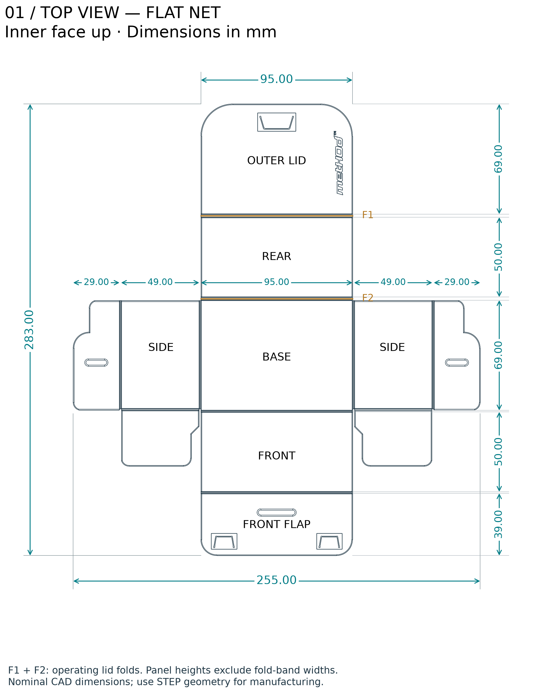
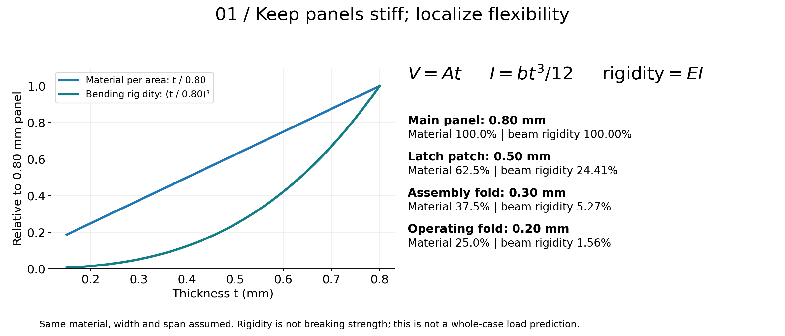
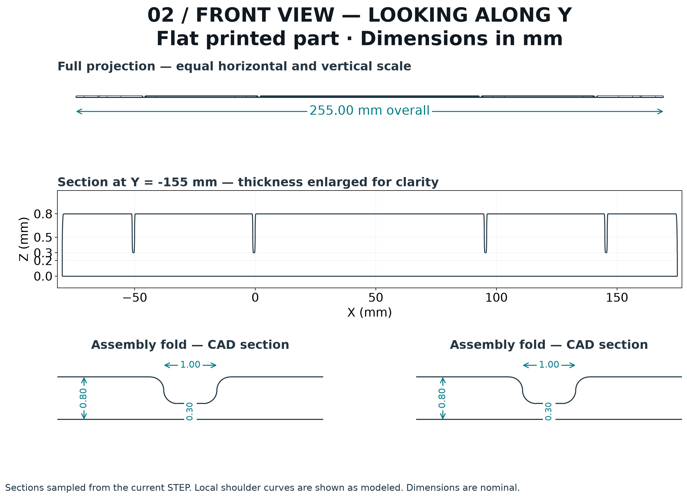
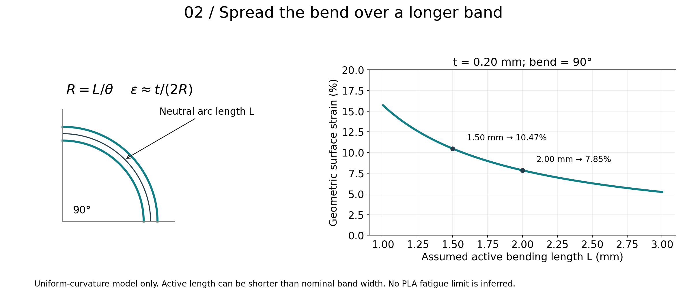
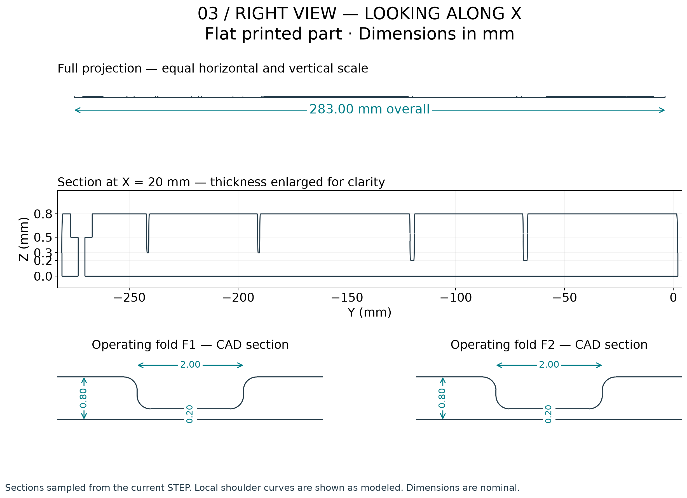
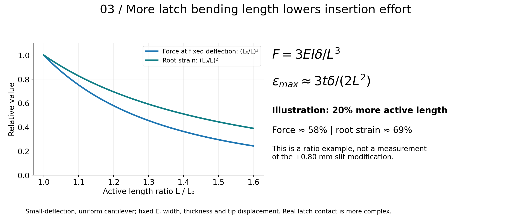
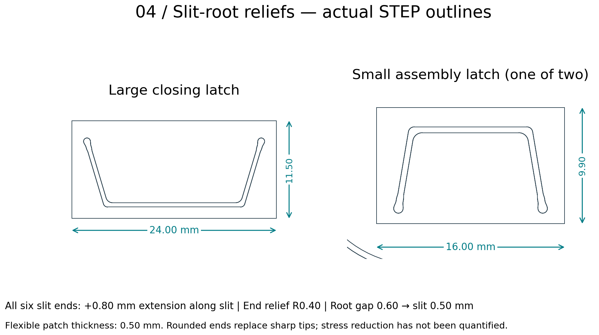

# Engineering notes

## Flat-part layout

The current STEP defines a 255 × 283 × 0.80 mm flat envelope. Dimensions shown are nominal CAD values, not printer tolerances. F1 and F2 identify the two operating lid folds. Assembled clearance also depends on bend shape, panel overlap, and print variation.

[Top SVG](images/engineering-top.svg) · [Front SVG](images/engineering-front.svg) · [Right SVG](images/engineering-side.svg)

## Thin panels and local flexibility

The main panels are 0.80 mm thick. Keeping a large panel thin reduces material approximately in proportion to thickness: **V ≈ A t**, where A is panel area and t is thickness.

For an ideal rectangular beam section, **I = b t³ / 12** and bending rigidity is E I. This cubic thickness dependence explains why reducing thickness everywhere can quickly make a panel much more flexible. FoldDeckCase instead uses local thin regions for folds and latches.

For the same material, width, and span, reducing thickness from 0.80 to 0.50 mm retains 62.5% of material per unit area but only about 24.4% of the ideal beam rigidity. This supports using localized flexible patches while retaining thicker panels. Rigidity means resistance to bending, not fracture strength.

This section is cut from the STEP at Y = −155 mm. The local details show the 0.80 mm panels and 0.30 mm minimum assembly-fold thickness. The full projection uses equal scales; the middle thickness plot is enlarged vertically.

## The two frequently operated fold bands

The two consecutive upper lid folds use nominal 2.00 mm bands with 0.20 mm minimum thickness. Other assembly folds use nominal 1.00 mm bands with 0.30 mm minimum thickness.

For ideal uniform bending, the outer-fiber strain can be approximated by **ε ≈ t θ / (2 L)**, where θ is in radians and L is the active bending length. A 0.20 mm band bent through 90 degrees over 2.00 mm gives roughly **7.85%**. If bending is concentrated into 1.50 mm, the same expression gives about **10.47%**.

These are geometric strain estimates, not allowable PLA strains or fatigue predictions. Printed strands, shoulder geometry, local creasing, and plastic deformation affect the real fold. A successful assembly does not establish repeated-cycle life.

The curve follows the geometric relation R = L/θ and ε ≈ t/(2R), with a centered neutral surface. It illustrates why a sharp crease concentrates deformation. It is not a material allowable-strain curve.

The section at X = 20 mm crosses both operating folds, F1 and F2. Their nominal 2.00 mm width is measured between panel boundaries; the curved transitions mean this is not automatically the active bending length L in the strain equation.

## Latch-root reliefs

All three hooks retain their tip and window locations. Each of the six slit endpoints extends 0.80 mm along its original slit direction toward the root, ending in an R0.40 mm relief. The widened root slit is 0.60 mm and transitions into the original 0.50 mm slit.

The surrounding 0.50 mm-thick flexible patches have square perimeter transitions in this version. The large patch is 24.00 × 11.50 mm; each smaller patch is 16.00 × 9.90 mm.

For an ideal small-deflection cantilever, **F = 3 E I δ / L³** and **εmax ≈ 3 t δ / (2 L²)**. At a fixed opening displacement δ, increasing active length L reduces the required force and root strain. Rounded slit ends remove sharp geometric tips, but these equations do not capture the actual large-deflection latch contact or establish its strength.

As an illustrative ratio, increasing active length by 20% gives 1/1.2³ ≈ 58% of the original force and 1/1.2² ≈ 69% of the original root strain, at the same imposed tip displacement. This is not a measured improvement for this case: the +0.80 mm slit change does not by itself establish the effective length increase.

The relief circles replace sharp slit ends with finite-radius boundaries. They also remove material from the ligament, so a larger radius is not automatically better. The final geometry needs adequate remaining material and physical checks.

## Symbols and assumptions

| Symbol | Meaning |
| --- | --- |
| A, V | Panel area and volume |
| b, t | Beam width and bending thickness |
| E, I | Elastic modulus and second moment of area |
| L, L₀ | Active bending length and reference length |
| θ, R | Bend angle in radians and neutral-surface radius |
| δ, F | Imposed tip displacement and corresponding force |
| ε | Surface strain |

The beam calculations assume uniform sections and small elastic deflections. Printed PLA is direction-dependent, and actual folding can involve large rotations and permanent deformation. Injection-molded living-hinge practice provides useful design context but does not establish fatigue performance for this FDM PLA case.

## Validation scope

The designer reports that double-sleeved cards using Dragon Shield Standard Matte outer sleeves fit and work in the printed case. The inner-sleeve model, stack count, and measured clearance have not been specified; this does not establish a universal capacity or validate the latest engraving revision.

The v1.5 STEP file is a valid single solid and its mesh and seven-layer print project have been checked. Earlier printed prototypes and the faster print approach worked in the designer's tests. The designer reported a successful v1.5 print on October 20, 2026. Quantified testing of latch performance remains outstanding. No quantified drop, crush, retention-force, or hinge-fatigue results are available.

Useful next measurements are actual filament mass, complete print time, latch opening force, and the number of lid cycles before visible whitening or cracking.

## References and further reading

- [MIT OpenCourseWare — Structural Mechanics, Recitation 5](https://ocw.mit.edu/courses/2-080j-structural-mechanics-fall-2013/de27f1d8f647ff995771d4b8d48d34bc_MIT2_080JF13_Recitation5.pdf): rectangular-section second moment of area and end-loaded cantilever deflection.
- [Protolabs — How to Design 3D-Printed Living Hinges](https://www.protolabs.com/resources/blog/how-to-design-3d-printed-living-hinges/): process and material considerations for printed hinges.
- [Protolabs — Designing Living Hinges That Fold Flat](https://www.protolabs.com/resources/design-tips/designing-living-hinges-that-fold-flat/): injection-molding context; its material and process recommendations are not validation of this PLA print.

The plots are original illustrations calculated from the equations above. Latch outlines and the engineering sections are derived from the project STEP. No referenced source has tested or endorsed FoldDeckCase.
