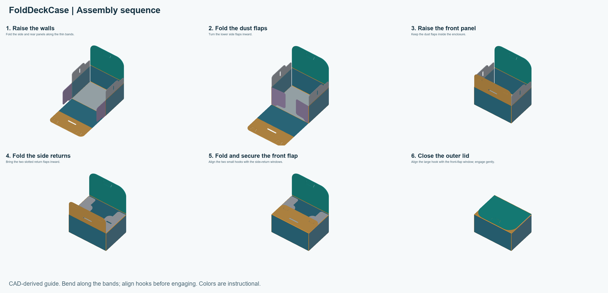

# Printing and assembly

## Reference setup

Use the supplied Basic 3MF as a project in Bambu Studio. The reference machine is a Bambu Lab A1 with a 0.4 mm nozzle, PLA/PLA+, and a textured or matte build surface. Select the actual plate and material you use.

Keep the outer face down and the fold reliefs up. Basic needs no supports. Preserve the saved diagonal placement at 100% scale: the unrotated net is 255 × 283 mm and the approximately 45-degree envelope is 254.86 × 254.86 mm, close to the nominal 256 mm bed size.

## Seven-layer schedule

| Layer | Height | Top Z |
| --- | --- | --- |
| 1 | 0.10 mm | 0.10 mm |
| 2 | 0.10 mm | 0.20 mm |
| 3 | 0.10 mm | 0.30 mm |
| 4 | 0.10 mm | 0.40 mm |
| 5 | 0.10 mm | 0.50 mm |
| 6 | 0.20 mm | 0.70 mm |
| 7 | 0.10 mm | 0.80 mm |

The first five layers preserve the thin hinges and latch patches. The thicker sixth layer reduces the layer count in the main panels. Do not replace this schedule with a uniform 0.20 mm layer height.

The profile requests 350 mm/s internal solid infill. This is a requested speed, not the speed of every path: acceleration, cooling, and volumetric flow limits can reduce it. Keep the supplied profile as a baseline and change one variable at a time.

Total slicer estimate: **1 h 33 min 2 s**, including the slicer's startup allowance. Model printing estimate: **1 h 26 min 7 s**. Filament estimate: **40.75 g**, using the saved material profile.

<!-- MEDIA 04: Layer-preview screenshots showing both hinge layers and the seventh layer. -->

## Assembly

1. Let the plate cool. Support the broad panels while releasing the sheet; avoid pulling on a thin fold band.
2. Identify the fold bands with the grooved inner face up. Fold along the bands rather than across the panels.
3. Raise the side and rear panels, then turn the side dust flaps inward.
4. Raise the front panel, keeping the dust flaps inside.
5. Fold the slotted side-return flaps inward.
6. Fold the front flap and align its two smaller hooks with the side-return windows. Engage them gently.
7. Close the outer lid and align its larger hook with the window in the front flap.

[Watch or download the MP4 animation](images/assembly.mp4).

These CAD-derived views show an illustrative sequence using the actual panel shapes and thicknesses. Fold bands use an idealized bend model; elastic hook insertion is not simulated. Use the alignment and feel of the printed part to guide engagement.

If a latch needs excessive force, stop and check the fold locations and window alignment. PLA may whiten, crack, or permanently crease when overstressed. The two operating lid bands should take the repeated folding; avoid repeatedly unfolding assembly-only corners.

The designer reports successful use with double-sleeved cards using Dragon Shield sleeves. The exact sleeve combination and tested card count were not recorded. Check your own stack without forcing the closure; a universal card capacity has not been established.
