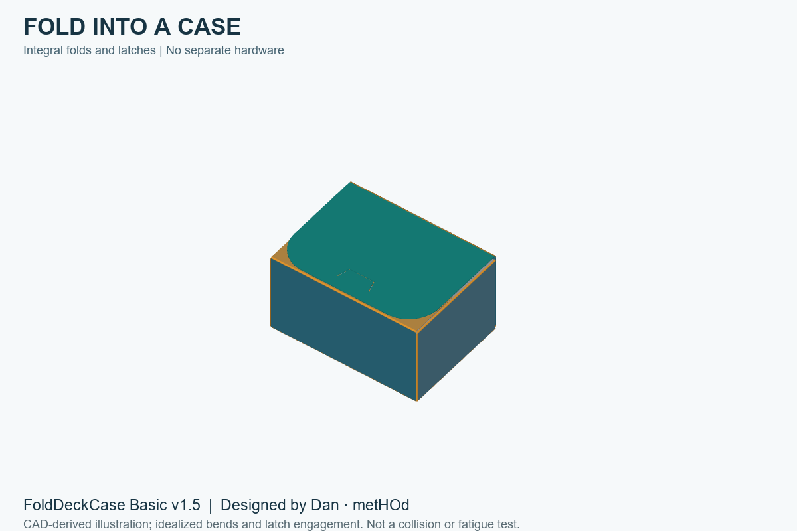
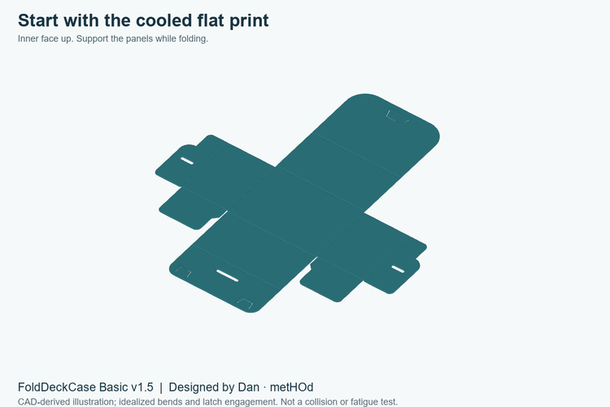
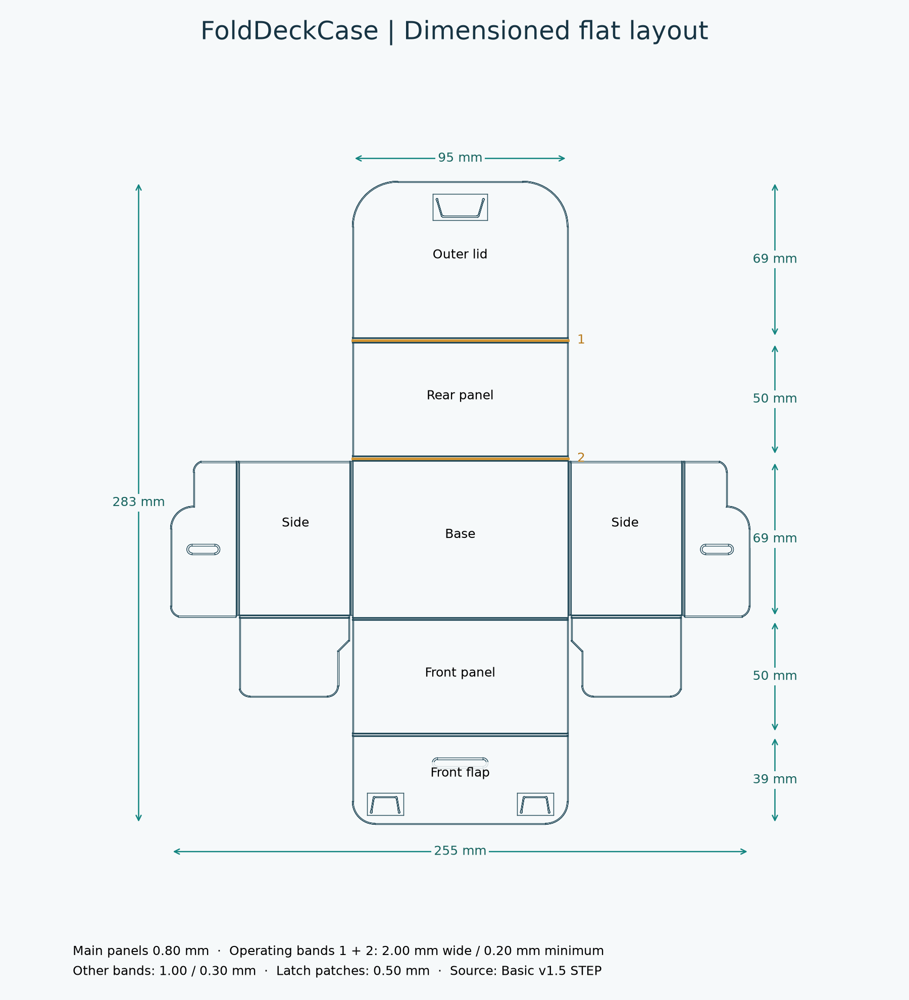
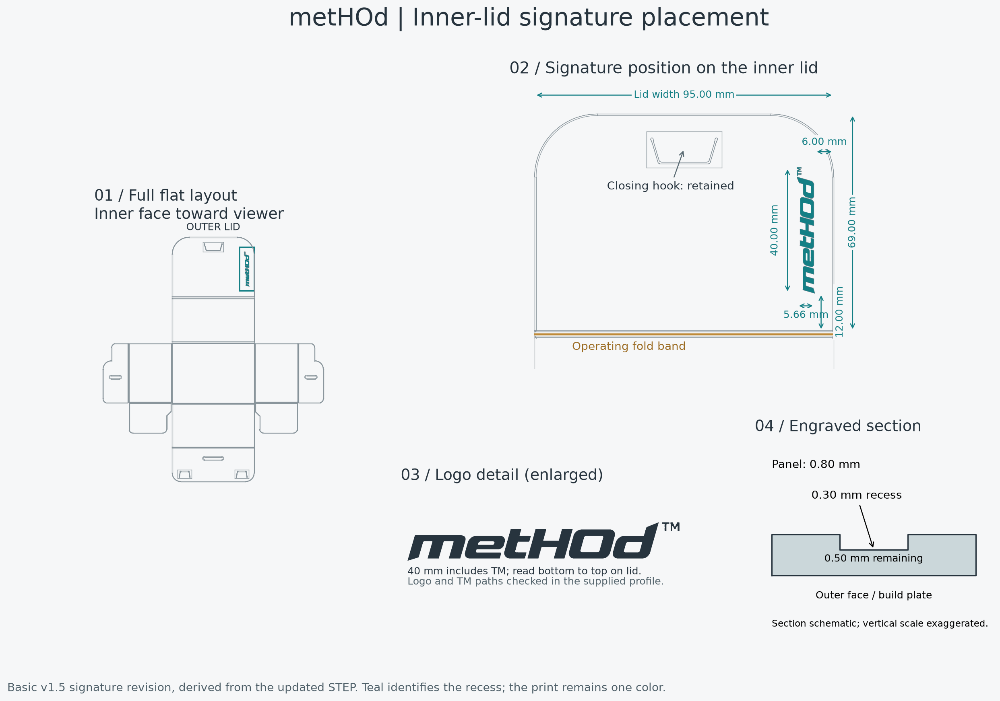

# FoldDeckCase

**Designed by Dan · metHOd**

### Print flat. Fold. Carry.

Not every stack of cards needs a heavy deck box.

FoldDeckCase is a thin, single-piece, 3D-printable card carrier that folds into shape. It is made for everyday moments: bringing new cards home, carrying trades, or keeping a spare stack together.

Printed flat. Assembled by folding. No separate hardware.

*CAD-derived illustration of Basic v1.5. Panel colors explain the construction; they do not indicate a multicolor print.*

<!-- OPTIONAL: Replace or supplement this render with a real assembled-product photo. -->

**One plate · One piece · Seven layers · 93-minute print estimate · 41 g filament estimate**

## Why FoldDeckCase?

- **One build plate, one piece.** Print the entire case flat in a single job.
- **No extra hardware.** Integral tabs and slots hold the case together—no screws, magnets, or glue.
- **Just 7 printed layers.** The supplied profile builds the thin sheet without tall vertical walls.
- **About 1½ hours to print.** Basic v1.5 has a total slicer estimate of **1 hour 33 minutes** on the supplied Bambu Lab A1 profile; folding takes additional time.
- **About 41 g of filament.** A small material budget for an everyday card carrier.
- **No supports for Basic.** Print the plain version with its outer surface against the build plate.

Time and weight are slicer estimates for the included profile, not guaranteed measurements. Material, printer setup, and settings affect results.

## When you just need a card carrier

Sometimes you need somewhere to put cards after a purchase, a lightweight carrier for trading, or a home for spare cards. FoldDeckCase puts a thin enclosure around that stack without requiring a substantial printed box.

| Carrier | Useful when | Main trade-off |
| --- | --- | --- |
| Sleeves or a bag | You need very little bulk | Limited structure around the stack |
| A cardboard card box | You want simple storage without printing | Paperboard can wear or soften when wet |
| FoldDeckCase | You want a printable, editable, lightweight carrier | Requires folding; thin panels and PLA hinges have limits |
| A thick rigid deck box | You need a more substantial enclosure | Usually more bulk; printing effort depends on the design |

FoldDeckCase is a light-duty carrier. It is not rated for crushing, water protection, or long-term hinge fatigue. Check the fit with your own cards and sleeves.

## Print Basic

Start with **[foldeckcasev1.5_metHOd.3mf](print/foldeckcasev1.5_metHOd.3mf)** in Bambu Studio. This is the Basic v1.5 signature revision, with a recessed metHOd mark on the inner lid. It includes the flat placement and faster seven-layer setup. For design edits, download the **[STEP model](cad/foldeckcasev1.5_metHOd.step)**.

1. Open the 3MF as a project to retain its settings.
2. Confirm your printer, nozzle, build plate, and filament match your setup.
3. Keep the existing orientation and scale. Slice and inspect the first layers and thin fold bands before printing.
4. Let the sheet cool before removing it, then fold and assemble it.

The reference setup is a **Bambu Lab A1, 0.4 mm nozzle, and PLA/PLA+**. The sheet fits diagonally with little spare bed space; check the sliced footprint and startup paths rather than auto-scaling it.

Read the [printing and assembly guide](docs/PRINTING_AND_ASSEMBLY.md) for the layer schedule and folding notes.

[Download the assembly animation (MP4)](images/assembly.mp4) · [View the assembly sheet](images/assembly-guide.png)

*The animation uses panels from the actual STEP file with idealized bending. It explains the folding sequence; it does not simulate elastic hook insertion or establish collision-free motion.*

<!-- OPTIONAL: Add a real folding and closing video here. -->

## How the design works

The case prints as a flat net. Thin fold bands connect the panels, and three integral hook-and-window pairs secure the folded structure.

| Feature | Basic v1.5 |
| --- | --- |
| Flat envelope | 255 × 283 mm |
| Main panel thickness | 0.80 mm |
| Two frequently operated lid fold bands | 2.00 mm nominal width; 0.20 mm minimum thickness |
| Other assembly fold bands | 1.00 mm nominal width; 0.30 mm minimum thickness |
| Flexible latch patches | 0.50 mm thickness |
| Number of latch pairs | 3 |

The lid's two frequently bent lines need different treatment from folds mainly used during assembly. Their thinner, wider bands distribute bending over more material length. The surrounding panels stay thicker to help the case retain its shape.

The latch slits extend toward the roots and end in rounded reliefs. This gives each tongue more bending length while keeping the hook tips and matching windows in place.

Read the [engineering notes](docs/ENGINEERING.md) for dimensions, equations, and the limits of these simplified models.

## Inner-lid maker signature

The current download includes a recessed **metHOd** wordmark and enlarged TM on the inner face of the outer lid. It prints in the same color as the case.

| Detail | Dimension |
| --- | --- |
| Overall mark, including TM | 40.00 × 5.66 mm |
| Clearance from straight right edge | 6.00 mm |
| Clearance from fold-band panel boundary | 12.00 mm |
| Recess depth | 0.30 mm |
| Remaining panel under the mark | 0.50 mm |

The recess floor sits at Z = 0.50 mm, matching the fifth layer. The seven-layer schedule, assembly features, and outside envelope remain unchanged. Inspect the small TM in the sliced preview before printing.

The assembly renders and animation above depict the original v1.5 without the signature; the folding sequence is unchanged.

## What has been tested?

Earlier prototypes were physically printed and assembled successfully on an A1. The faster print setup and fold lines also worked in the designer's tests.

**Basic v1.5 has now been successfully printed**, as reported by the designer on October 20, 2026. The STEP model has also been checked as a valid single solid, and the supplied project has been sliced successfully. The 93-minute duration and 40.79 g material use for that original version remain slicer estimates, not measured print results. No cycle-life or load rating is claimed.

The **signature revision** adds a 0.30 mm-deep inner-lid mark. Its STEP is valid, its mesh is watertight, and its seven-layer project has been sliced successfully. Its updated estimates are **1 h 33 min 2 s and 40.75 g**. This engraved revision has **not yet been physically print-tested**; the successful print above refers to the original v1.5.

## Share your build

Printed one? Share a photo and tell us your material, printer settings, card and sleeve size, and how the folds and latches behaved. Reports of awkward assembly or wear are especially useful for improving the design.

If this project is useful, a GitHub star helps other makers find it.

## License and reuse

**Print it. Modify it. Share your improvements.**

Copyright © 2026 Dan · metHOd.

The original Basic design files and documentation in this repository are licensed under [Creative Commons Attribution-NonCommercial-ShareAlike 4.0 International](https://creativecommons.org/licenses/by-nc-sa/4.0/). See [LICENSE](LICENSE) for the full terms.

You are welcome to print, adapt, and share the design for noncommercial purposes, with appropriate attribution, a license link, and an indication of changes. Shared adaptations must use the same or a compatible license.

Suggested credit: **FoldDeckCase by Dan · metHOd**, with a link to [this project](https://github.com/kuantienho/FoldDeckCase).

Commercial uses, including selling model files or printed copies, require separate permission. Contact [Dan on GitHub](https://github.com/kuantienho) to discuss commercial licensing. Creator sales and separately granted permissions help fund future design and testing.

Third-party artwork is not included in this Basic release and is not licensed by this notice.
