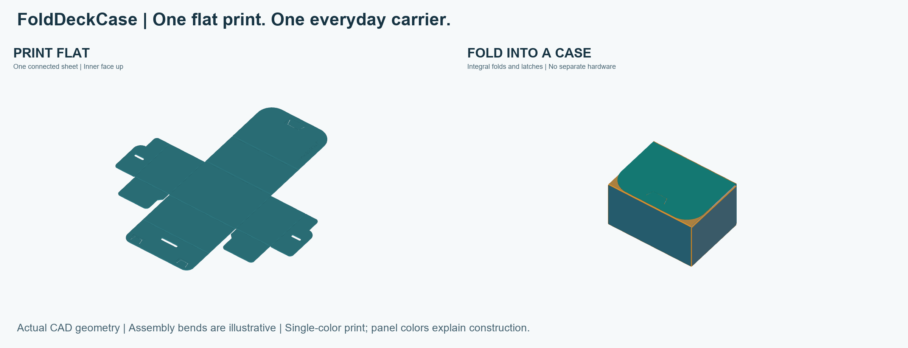

# FoldDeckCase

**Designed by Dan · metHOd**

[Print and assemble](#print-basic) · [Dimensions](#dimensions-and-construction) · [Engineering principles](#engineering-principles) · [Testing](#what-has-been-tested) · [License](#license-and-reuse)

### Print flat. Fold. Carry.

Not every stack of cards needs a heavy deck box.

FoldDeckCase is a thin, single-piece, 3D-printable card carrier that folds into shape. It is made for everyday moments: bringing new cards home, carrying trades, or keeping a spare stack together.

Printed flat. Assembled by folding. No separate hardware.

*The same one-piece design, before and after folding. Views use the current CAD geometry with idealized bends; colors distinguish panels, not filament changes.*

<!-- OPTIONAL: Replace or supplement this render with a real assembled-product photo. -->

**One plate · One piece · Seven layers · 93-minute print estimate · 41 g filament estimate**

## Why FoldDeckCase?

- **One build plate, one piece.** Print the entire case flat in a single job.
- **No extra hardware.** Integral tabs and slots hold the case together—no screws, magnets, or glue.
- **Just 7 printed layers.** The supplied profile builds the thin sheet without tall vertical walls.
- **About 1½ hours to print.** Basic v1.5 has a total slicer estimate of **1 hour 33 minutes** on the supplied Bambu Lab A1 profile; folding takes additional time.
- **About 41 g of filament.** A small material budget for an everyday card carrier.
- **No supports for Basic.** Print the plain version with its outer surface against the build plate.

Time and weight are slicer estimates for the included profile, not guaranteed measurements. Material, printer setup, and settings affect results.

## When you just need a card carrier

Sometimes you need somewhere to put cards after a purchase, a lightweight carrier for trading, or a home for spare cards. FoldDeckCase puts a thin enclosure around that stack without requiring a substantial printed box.

| Carrier | Useful when | Main trade-off |
| --- | --- | --- |
| Sleeves or a bag | You need very little bulk | Limited structure around the stack |
| A cardboard card box | You want simple storage without printing | Paperboard can wear or soften when wet |
| FoldDeckCase | You want a printable, editable, lightweight carrier | Requires folding; thin panels and PLA hinges have limits |
| A thick rigid deck box | You need a more substantial enclosure | Usually more bulk; printing effort depends on the design |

FoldDeckCase is a light-duty carrier. It is not rated for crushing, water protection, or long-term hinge fatigue. Check the fit with your own cards and sleeves.

## Print Basic

Start with **[foldeckcasev1.5_metHOd.3mf](print/foldeckcasev1.5_metHOd.3mf)** in Bambu Studio. It includes the current Basic model, saved flat placement, and faster seven-layer setup. For design edits, download the **[STEP model](cad/foldeckcasev1.5_metHOd.step)**.

1. Open the 3MF as a project to retain its settings.
2. Confirm your printer, nozzle, build plate, and filament match your setup.
3. Keep the existing orientation and scale. Slice and inspect the first layers and thin fold bands before printing.
4. Let the sheet cool before removing it, then fold and assemble it.

The reference setup is a **Bambu Lab A1, 0.4 mm nozzle, and PLA/PLA+**. The sheet fits diagonally with little spare bed space; check the sliced footprint and startup paths rather than auto-scaling it.

Read the [printing and assembly guide](docs/PRINTING_AND_ASSEMBLY.md) for the layer schedule and folding notes.

[Download the assembly animation (MP4)](images/assembly.mp4) · [View the assembly sheet](images/assembly-guide.png)

*The animation uses the original v1.5 panel geometry with idealized bending. The folding sequence remains applicable to the current model. It does not simulate elastic hook insertion or establish collision-free motion.*

<!-- OPTIONAL: Add a real folding and closing video here. -->

## How the design works

The case prints as a flat net. Thin fold bands connect the panels, and three integral hook-and-window pairs secure the folded structure.

| Feature | Basic v1.5 |
| --- | --- |
| Flat envelope | 255 × 283 mm |
| Main panel thickness | 0.80 mm |
| Two frequently operated lid fold bands | 2.00 mm nominal width; 0.20 mm minimum thickness |
| Other assembly fold bands | 1.00 mm nominal width; 0.30 mm minimum thickness |
| Flexible latch patches | 0.50 mm thickness |
| Number of latch pairs | 3 |

### Dimensions and construction

The flat net measures **255 × 283 mm**, with a **95 mm-wide central panel strip**. The panel dimensions exclude the narrow fold bands. These are flat-part dimensions, not a claimed assembled internal capacity.

The three drawings separate the overall footprint from the thin cross-sections:

- [Top view — panel layout and dimensions](images/engineering-top.png) · [Vector drawing](images/engineering-top.svg)
- [Front view — width and assembly-fold sections](images/engineering-front.png) · [Vector drawing](images/engineering-front.svg)
- [Right-side view — length and operating-fold sections](images/engineering-side.png) · [Vector drawing](images/engineering-side.svg)

Full projections retain equal axis scales. The thickness plots are explicitly enlarged; local sections show the actual modeled shoulder curves.

The lid's two frequently bent lines need different treatment from folds mainly used during assembly. Their thinner, wider bands distribute bending over more material length. The surrounding panels stay thicker to help the case retain its shape.

The latch slits extend toward the roots and end in rounded reliefs. This gives each tongue more bending length while keeping the hook tips and matching windows in place.

Read the [engineering notes](docs/ENGINEERING.md) for dimensions, equations, and the limits of these simplified models.

## Engineering principles

The following models explain the design choices. They describe geometric and elastic trends; they are not measured load ratings or fatigue-life predictions.

### Panel thickness and local flexibility

The main panels are 0.80 mm thick. For a uniform panel, material volume scales linearly with thickness:

$$
V = A t .
$$

Here, $A$ is panel area and $t$ is thickness.

For an ideal rectangular beam section, the second moment of area and flexural rigidity are

$$
I = \frac{b t^3}{12}, \qquad EI = E\,\frac{b t^3}{12}.
$$

Here, $b$ is section width and $E$ is Young's modulus. The units of $I$ and $EI$ are $\mathrm{mm}^4$ and $\mathrm{N}\cdot\mathrm{mm}^2$, respectively. This cubic thickness dependence explains why reducing thickness everywhere can quickly make a panel more flexible. FoldDeckCase instead uses local thin regions for folds and latches.

For equal material, width, and span, relative to $t_0 = 0.80\,\mathrm{mm}$,

$$
\frac{V}{V_0} = \frac{t}{t_0}, \qquad
\frac{EI}{EI_0} = \left(\frac{t}{t_0}\right)^3.
$$

For the same material, width, and span, reducing thickness from 0.80 to 0.50 mm retains 62.5% of material per unit area but only about 24.4% of the ideal beam rigidity. This supports using localized flexible patches while retaining thicker panels. Rigidity means resistance to bending, not fracture strength.

This section is cut from the STEP at Y = −155 mm. The local details show the 0.80 mm panels and 0.30 mm minimum assembly-fold thickness. The full projection uses equal scales; the middle thickness plot is enlarged vertically.

### The two frequently operated fold bands

The two consecutive upper lid folds use nominal 2.00 mm bands with 0.20 mm minimum thickness. Other assembly folds use nominal 1.00 mm bands with 0.30 mm minimum thickness.

For uniform-curvature bending with a centered neutral surface,

$$
R = \frac{L}{\theta}, \qquad
\varepsilon \approx \frac{t}{2R} = \frac{t\theta}{2L}.
$$

Here, $\theta$ is the bend angle in radians and $L$ is the active bending length. For $t = 0.20\,\mathrm{mm}$ and $\theta = \frac{\pi}{2}$,

$$
\begin{aligned}
L=2.00\,\mathrm{mm}:\quad \varepsilon &\approx \frac{0.20\left(\frac{\pi}{2}\right)}{2(2.00)} = 0.0785 = 7.85\%,\\
L=1.50\,\mathrm{mm}:\quad \varepsilon &\approx \frac{0.20\left(\frac{\pi}{2}\right)}{2(1.50)} = 0.1047 = 10.47\%.
\end{aligned}
$$

These are geometric strain estimates, not allowable PLA strains or fatigue predictions. Printed strands, shoulder geometry, local creasing, and plastic deformation affect the real fold. A successful assembly does not establish repeated-cycle life.

The curve follows the geometric relations above, with a centered neutral surface. It illustrates why a sharp crease concentrates deformation. It is not a material allowable-strain curve.

The section at X = 20 mm crosses both operating folds, F1 and F2. Their nominal 2.00 mm width is measured between panel boundaries; the curved transitions mean this is not automatically the active bending length L in the strain equation.

### Latch-root reliefs

All three hooks retain their tip and window locations. Each of the six slit endpoints extends 0.80 mm along its original slit direction toward the root, ending in an R0.40 mm relief. The widened root slit is 0.60 mm and transitions into the original 0.50 mm slit.

The surrounding 0.50 mm-thick flexible patches have square perimeter transitions in this version. The large patch is 24.00 × 11.50 mm; each smaller patch is 16.00 × 9.90 mm.

For a uniform, end-loaded cantilever under small elastic deflections,

$$
\delta = \frac{F L^3}{3EI}, \qquad
F = \frac{3EI}{L^3}\,\delta, \qquad
\varepsilon_{\max} \approx \frac{3t\delta}{2L^2}.
$$

The symbol $\delta$ denotes tip displacement, not stress or strain. At a fixed opening displacement, increasing the active length $L$ reduces the required force and root strain. Rounded slit ends remove sharp geometric tips, but these equations do not capture the actual large-deflection latch contact or establish its strength.

At the same imposed tip displacement, a 20% increase in active length gives

$$
\frac{F}{F_0}=\left(\frac{L_0}{L}\right)^3=\frac{1}{1.2^3}\approx0.579,
\qquad
\frac{\varepsilon_{\max}}{\varepsilon_{\max,0}}=\left(\frac{L_0}{L}\right)^2=\frac{1}{1.2^2}\approx0.694.
$$

These represent approximately 58% of the reference force and 69% of the reference root strain. This is not a measured improvement for this case: the +0.80 mm slit change does not by itself establish the effective length increase.

The relief circles replace sharp slit ends with finite-radius boundaries. They also remove material from the ligament, so a larger radius is not automatically better. The final geometry needs adequate remaining material and physical checks.

### Symbols and assumptions

| Symbol | Meaning |
| --- | --- |
| $A$, $V$ | Panel area and volume |
| $b$, $t$ | Beam width and bending thickness |
| $E$, $I$ | Elastic modulus and second moment of area |
| $L$, $L_0$ | Active bending length and reference length |
| $\theta$, $R$ | Bend angle in radians and neutral-surface radius |
| $\delta$, $F$ | Imposed tip displacement and corresponding force |
| $\varepsilon$ | Surface strain |

The beam calculations assume uniform sections and small elastic deflections. Printed PLA is direction-dependent, and actual folding can involve large rotations and permanent deformation. Injection-molded living-hinge practice provides useful design context but does not establish fatigue performance for this FDM PLA case.

### References

- [MIT OpenCourseWare — Structural Mechanics, Recitation 5](https://ocw.mit.edu/courses/2-080j-structural-mechanics-fall-2013/de27f1d8f647ff995771d4b8d48d34bc_MIT2_080JF13_Recitation5.pdf): rectangular-section second moment of area and end-loaded cantilever deflection.
- [Protolabs — How to Design 3D-Printed Living Hinges](https://www.protolabs.com/resources/blog/how-to-design-3d-printed-living-hinges/): process and material considerations for printed hinges.
- [Protolabs — Designing Living Hinges That Fold Flat](https://www.protolabs.com/resources/design-tips/designing-living-hinges-that-fold-flat/): injection-molding context; its material and process recommendations are not validation of this PLA print.

The plots are original illustrations calculated from the equations above. Latch outlines and the engineering sections are derived from the project STEP. No referenced source has tested or endorsed FoldDeckCase.

## What has been tested?

**Card fit:** the designer has tested double-sleeved cards using Dragon Shield Standard Matte outer sleeves and reports that they fit and work in the printed case. The inner-sleeve model and card count have not been specified, so this is a fit report rather than a rated capacity or a guarantee for every sleeve combination.

Earlier prototypes were physically printed and assembled successfully on an A1. The faster print setup and fold lines also worked in the designer's tests.

**Basic v1.5 has now been successfully printed**, as reported by the designer on October 20, 2026. The STEP model has also been checked as a valid single solid, and the supplied project has been sliced successfully. The 93-minute duration and 40.79 g material use for that original version remain slicer estimates, not measured print results. No cycle-life or load rating is claimed.

The current download has a valid single-solid STEP, a watertight mesh, and a successfully sliced seven-layer project. Updated estimates are **1 h 33 min 2 s and 40.75 g**. Physical print confirmation applies to the earlier v1.5; the latest revision is still awaiting its own print test. See the [release notes](docs/RELEASE_NOTES.md) for the change history.

## Share your build

Printed one? Share a photo and tell us your material, printer settings, card and sleeve size, and how the folds and latches behaved. Reports of awkward assembly or wear are especially useful for improving the design.

If this project is useful, a GitHub star helps other makers find it.

## License and reuse

**Print it. Modify it. Share your improvements.**

Copyright © 2026 Dan · metHOd.

The original Basic design files and documentation in this repository are licensed under [Creative Commons Attribution-NonCommercial-ShareAlike 4.0 International](https://creativecommons.org/licenses/by-nc-sa/4.0/). See [LICENSE](LICENSE) for the full terms.

You are welcome to print, adapt, and share the design for noncommercial purposes, with appropriate attribution, a license link, and an indication of changes. Shared adaptations must use the same or a compatible license.

Suggested credit: **FoldDeckCase by Dan · metHOd**, with a link to [this project](https://github.com/kuantienho/FoldDeckCase).

Commercial uses, including selling model files or printed copies, require separate permission. Contact [Dan on GitHub](https://github.com/kuantienho) to discuss commercial licensing. Creator sales and separately granted permissions help fund future design and testing.

Third-party artwork is not included in this Basic release and is not licensed by this notice.
